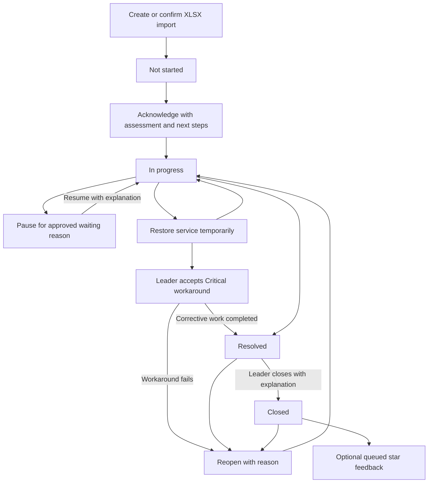

# TCC Purrtal ticketing — current system guide

Last audited against repository code: **10 November 2026**.
This guide describes the current implementation, rather than earlier designs. Changes in this documentation update do not deploy code or change data.

## Documentation index

| Document | Purpose |
| --- | --- |
| [TICKETING.md](TICKETING.md) | Start here: current screens, roles, workflow, data, routes, filters, XLSX, operations and verification |
| [SLA_IMPLEMENTATION.md](SLA_IMPLEMENTATION.md) | Exact timing rules, clock behavior, milestones, alerts and reporting definitions |
| [TICKETING_CODE_MAP.md](TICKETING_CODE_MAP.md) | Frontend/backend file inventory, entry points, migrations and test responsibilities |
| [TICKETING_CHANGELOG.md](TICKETING_CHANGELOG.md) | Implemented changes, superseded behavior and local data-maintenance history |

The code map links directly to repository files. The documentation must be updated in the same change as any affected implementation; see the maintenance checklist below.

## Architecture and entry points

The module uses the project's existing Laravel + React + Inertia stack. It reuses authenticated application navigation, the Select Module header, profile controls and website notification bell. XLSX support uses the already installed Laravel Excel/PhpSpreadsheet dependencies; charts, medals, sidebar icons and star controls use inline SVG without another frontend framework.

Open **IT Ticketing Module** from the header's module selector or visit `/tickets/dashboard`. Every workflow role lands on its dashboard. Creation is a separate URL, `/tickets/create`; tables and the creation form are never shown side by side. React's `Index.jsx` renders the requested screen from server props, including `creationPage`, `filters.view` and `ticketRole`.

## Roles and access

Names are matched exactly after trimming and lowercasing, using [config/ticketing.php](config/ticketing.php).

| Workflow role | Configured account roles | Access |
| --- | --- | --- |
| Employee | Any role outside the configured member/leader lists | Create tickets; dashboard and lists for own creator ID only; reply; confirm resolved service; optional feedback after closure |
| IT member | IT Member, IT Staff, IT Intern | Dashboard for current assignments; Assigned to me and All tickets; manage only own assignments; create an IT-reported ticket |
| IT leader | IT TL, IT Team Leader, IT Supervisor | Team dashboard, all/open/closed/own-assignment tables, reports, staff workload, leaderboard; priority changes, assignment/reassignment, management, closure, Critical workaround approval, XLSX import |

IT leaders are valid ticket assignees. On an unassigned ticket, substantive IT action can establish the acting worker as owner; changing priority alone can leave it unassigned. Members cannot claim arbitrary unassigned tickets through a crafted update, because current assignment is checked under a row lock.

Employees can choose their primary or linked branches. Executive Vice President, Executive Assistant, IT, IT Admin and configured IT members/leaders can choose any existing branch. Employees whose account department is Information Technology may also select any existing branch, regardless of workflow role. Branch exceptions do not grant management rights. Clinic branches come from the branch directory. Active ticket-only locations are available to all requesters.

**All tickets** means all tickets authorized for that role and environment: an employee still sees only their own tickets. Admin/IT/other unlisted role names do not implicitly become IT staff workflow roles.

### Local role testing

Sign in with a local test account to exercise that account’s ticket permissions. Run `php artisan db:seed --class=LocalRoleAccountsSeeder` in the local `tcc_purrtal_local` database, then run `php artisan db:seed --class=LocalRoleTicketsSeeder` to create one sample in each ticket status per role. Legacy preview records stay outside the normal ticket views.

## Frontend screens and navigation

### Assignment handover

IT Team Leaders and Supervisors can open **Admin → Handover**, select an active IT member, and set the start and end dates. Both dates are inclusive in clinic time. Leaders can revoke a scheduled or active grant. Access expires automatically at the end of the final day.

During an active grant, the member can choose **Assign ticket during handover** from the ticket details and assign or reassign eligible tickets to active IT members. The grant covers assignment only. Closed, rejected, and revision-pending tickets are excluded. The server locks and checks the grant and ticket on each assignment, records the acting member in ticket history, and sends the usual assignment notification.

IT Team Leaders and Supervisors can **Reject** a ticket submitted by an IT member or **Send back for revision** with a required comment. Rejected tickets stay in the ticket list and are excluded from leaderboard counts. The creator receives a notification linking to **Pending revisions**, where they can edit their intake details and resubmit. Resubmission preserves the ticket ID, category, and location, returns it to In progress, and resumes the resolution timer with its accumulated support time.

IT Team Leaders and Supervisors can open **Admin → Locations** to view the clinic branch codes and add ticket locations with unique names and codes. New codes require exactly three ASCII letters or digits and are saved in uppercase. Extra locations are stored separately from the branch directory and are available to everyone on the Create ticket page. The existing branch rules still apply to clinic branches.

Use **Remove** to retire a custom location from new ticket requests. Existing tickets retain that location and can still be filtered by it. Retired names and codes remain reserved for ticket history.

Use the sidebar to switch ticket pages. Ticket lists do not repeat the sidebar links as tabs; search, filters, sorting and pagination remain on the list.

Dashboards group ticket widgets under **All Tickets** (total, closed, leader closure periods, and staff priority counts across all statuses) and **Open Tickets** (open total, not started, in progress, resolved awaiting closure, and leader active queues). Percentages continue to use the role's full ticket total. Clicking a card opens the matching scope; unrelated date, priority or closure filters are cleared for the all-time status totals. Quick actions and personal ratings remain separate.

Displayed percentages use exactly two decimal places, including zero and whole-number percentages. This also applies to SLA compliance/reopen percentages, leaderboard shares and XLSX percentage values; counts and star ratings keep their own formats.

### Employee dashboard

- Employee dashboard cards show Total, Open, Not started, In progress and Resolved. Each shows a count and percentage of the employee’s total. The Resolved card opens the employee’s resolved tickets awaiting closure.
- **Need IT support?**, Create ticket and View my tickets are at the top.
- Sidebar: Dashboard, Create ticket, All my tickets. Use the status filter for open or closed tickets.
- Cards open the corresponding status-filtered ticket list.

### IT member dashboard

- Same status counts/percentages, using currently assigned tickets rather than team-wide tickets.
- Support-workload quick actions link to creation, own assignments and all tickets.
- Own resolver rating: average out of five and number of rated tickets; missing feedback shows Not rated yet.
- Priority cards: Critical, High, Medium and Low. Counts include all currently assigned statuses. Clicking clears incompatible status/date/closure filters and opens the matching assignments.
- Sidebar includes Dashboard, Create ticket, Assigned to me and All tickets, with thin outline icons and selected-state styling.

### IT leader dashboard and reports

- **Manage team support** is at the top.
- Dashboard categories match Ticket reports: Total, Not started, In progress, Resolved, Closed, Unassigned active. Counts include the selected live/preview environment, independently of table filters.
- Dashboard percentages divide by total environment tickets. Active unassigned/unclassified queues overlap status counts and should not be added to them.
- Clickable closure totals: Today, This week, This month, This year, using `closed_at` in Asia/Manila. Periods overlap.
- Priority cards include all team tickets and open the corresponding priority-filtered All tickets table.
- Ticket reports cards and closure totals on list pages are keyboard-accessible links that filter the destination table; matching selections are highlighted.
- Staff workload includes assignable members **and leaders**, including zero-assignment accounts. Assignment and resolved counts follow current assignee; resolved includes closed. Completion percentage = assigned resolved/closed ÷ all assigned. Ratings follow the actual resolver, not current assignment.
- The leader dashboard shows the SLA performance panel with grouped metrics, branch backlog and expandable definitions. The ticket lists, including **Assigned to me**, do not display this panel.
- Sidebar includes Dashboard, Leaderboard, Create ticket, All tickets and Assigned to me. Open and closed tickets are status filters.

### Leaderboard

Each employee drill-down has an XLSX export for the selected date range and view: resolved tickets, overdue tickets, or ratings and comments. The export includes all matching rows across pages.

Leader-only `/tickets/leaderboard`, implemented by `TicketLeaderboard.php` and `TicketLeaderboard.jsx`.

- Podium cards have a common baseline and stationary heights in rank order. Only the cat icons bob, and reduced-motion preferences suppress that animation. The pie legend footer shows total resolutions and total share (100.00% with resolutions, 0.00% without).
- Click a member’s resolved count, overdue text or rating to open a detail view for that member and calendar period. All three drill-downs open full ticket details from the subject, including ratings rows. Ratings show the latest counted score per ticket and its comment. The views paginate at 15 entries. Clickable leaderboard values have no underline and retain keyboard focus styling.

- Top cats podium: second left/silver, first center/gold, third right/bronze, with cat medals. Only positive-resolution members occupy podium slots; missing places show an empty state.
- Pie chart and legend: member names, resolved counts and contribution percentages, using exact counts for segment sizes.
- Ranking table: rank, employee name/role/branches, tickets resolved, contribution share, average resolver rating out of five with rated-ticket count, and attention/overdue work. Top-three cards also show average rating. Members without feedback show Not rated yet (0 rated tickets).
- The leaderboard includes the current IT member, IT intern and IT team leader roster, including staff with zero resolutions.
- Selected-period resolved/closed tickets count once for `sla_state.resolved_by`, falling back to the latest resolved activity actor. Current assignee is never substituted for resolver.
- Reopened tickets are excluded until resolved again. Historical events are not counted as separate resolutions.
- Leaderboard ratings use the latest feedback per ticket in the selected live/preview environment, attributed to frozen resolved_by or the preceding resolved activity actor. Half-star values are retained in averages, displayed to one decimal. Reassignment does not move ratings. Existing feedback remains attributed even if its ticket is reopened; completion counts still exclude reopened work. Ratings do not affect ranking, podium order or pie shares.
- Contribution = each person's resolutions ÷ all ranked staff resolutions. Zero denominator yields 0%.
- Equal totals share competition rank; names then IDs break display ties. The podium displays at most three members, even if more tie.
- Overdue = current open assignments with an enabled, incomplete, breached resolution SLA. Accepted workarounds are not outstanding overdue work. Historical breaches on completed tickets are not this column's definition.
- Ranking explanations are expandable. The page matches the supplied white-card/pale-blue-table reference and adapts to narrow screens. A Day/Week/Month/Year/All time selector uses current calendar periods in Asia/Manila (All time is default). Resolution counts use latest resolution date; ratings use feedback-submission date; overdue counts use ticket creation date and current overdue state. Top three, ranking and pie shares recalculate. Export leaderboard XLSX downloads the same selected-period member rows with a Scope sheet.

## Ticket creation form and storage mapping

| Display order / field | Source or stored field | Rules |
| --- | --- | --- |
| Employee name | `creator_id`, `employee_name` | Server identity and name snapshot; read-only |
| Department | `employee_department` | Automatically displays the account department as read-only; server replaces submitted department with the account relationship name. Missing account department blocks creation and asks the user to contact an administrator. |
| Branch affected | `branch_id` | Required; shared branch-permission scope |
| Ticket subject | `subject` | Required, max 180 characters |
| Affected system, equipment, application or service | `affected_asset` | Required, max 255 |
| Ticket category | `category` | Hardware, Software, Network, Account & Access, Other; UI adds examples but stores canonical category only |
| Initial priority | `priority` | Required on the create-ticket form. Choose Critical (`critical`), High (`high`), Medium (`medium`) or Low (`low`). |
| Details of issue | `description` | Required, max 10,000 |
| Business or clinical operational impact | `operational_impact` | Required, max 5,000 |
| Screenshot or supporting-file links (optional) | `supporting_links` JSON array | Up to 10 HTTP/HTTPS URLs, max 2,048 characters each, one per line; no images/files uploaded or fetched |

Priority and ticket status are separate fields. Reporting time uses the server's ticket creation timestamp. SLA has its own UTC receipt field.

The button is **Create ticket** for all roles. IT-created form submissions still require email/Viber/other-messaging reporting channel and a reason the original ticket could not be created. They are assigned to the creating IT worker and use current creation/receipt time. Employee submissions use portal reporting, start unassigned, and cannot supply emergency-only fields. All form submissions require an initial priority. Every new ticket starts `not_started`; clients cannot set creator, initial status or arbitrary assignment.

Historical ticket names, department snapshots and retained descriptions are not rewritten to invent missing information.

## Workflow and management dialog



| Action | Behavior / required information |
| --- | --- |
| Assignment / priority / status | Leader may assign/reassign and revise priority with a reason. Staff may move assigned work to In progress; this alone is not acknowledgment. |
| Acknowledge | Assessment and next steps required. Records actual responder; starts In progress when Not started; requester is notified. Required before resolving an SLA ticket. |
| Send progress update | Message required. Optional vendor/reference/notification time, next-update estimate and related ticket ID in the same environment. |
| Document SLA risk / delay | Message, reason, actions taken, assistance/approval required and next-update estimate. Does not automatically extend or pause SLA. |
| Pause / resume | Approved reason plus message for pause; message for resume. Separate clock state, not a new ticket status. |
| Restore service temporarily | Workaround details required; remaining work/next steps optional. Ticket stays open and timer continues. |
| Accept Critical workaround and recovery plan | Leader-only, Critical ticket, already acknowledged. Details + plan required. Satisfies resolution target while corrective work remains open. |
| Resolve ticket | Issue found + Fix applied and verification required for tracked tickets. Records resolver, stops resolution work, notifies requester. Older detailed resolution payloads remain accepted for compatibility. |
| Confirm service is working | Requester-only, resolved ticket. Confirmation is optional; does not close the ticket. |
| Close ticket | Leader-only, must already be resolved; tracked tickets require resolution documentation and closure/follow-up explanation. Records `closed_at`. Requester confirmation is not enforced as a prerequisite. |
| Reopen | Leader or current assigned member, reason required for tracked tickets. Closed/resolved or accepted-workaround ticket returns to In progress, clears closure/confirmation, resumes original remaining allowance. |
| Reply / continuing issue | Requester-only, message required. Does not automatically reopen, resume a pause or close a ticket. |

Closed tickets must be reopened before further IT management. Employees cannot directly close, reopen, reassign or change priority after creation. No automatic closure exists. **Open tickets** includes Not started, In progress, Resolved and Pending revision. Rejected and Closed are excluded from Open. Resolved tickets await a separate closure action.

History is displayed oldest first, using creation timestamp then ID to break ties. Backend activity relationship remains newest-ID-first for latest-event attribution. Important actions, status transitions, assignments, warnings, replies, imports, ratings and dismissals are stored as activity entries.

### Review of IT member submissions

- Only an IT leader may reject or return tickets created by an IT member, including interns. The server reloads the ticket under a row lock and checks the creator’s role and current status. Not started, In progress and Resolved are eligible. A pending revision can still be rejected.
- Send back requires a comment, sets `revision_requested`, records the comment in activity history and sends the creator a database notification that links to Pending revisions.
- Reject sets `rejected`, records an optional reason, notifies the creator and keeps the ticket and history. Both review statuses are excluded from leaderboard resolutions, overdue totals and rating calculations.
- The revision queue selects only pending tickets created by the signed-in member. Resubmission validates the editable subject, issue details, affected system, impact, links and reporting details. It preserves the original ID, category, location and priority, records an activity, returns the ticket to In progress and notifies the leader who requested the revision.
- Normal management and requester actions are blocked while a ticket is pending revision or rejected. The resolution clock stops during the hold and resumes accumulated time after resubmission. Prior resolution and workaround state are cleared on resubmission so the work can be resolved again.

## Optional half-star feedback

The old Rate the resolving IT staff dropdown option is removed from the visible management actions. `TicketFeedbackQueue.jsx` displays a modal in the ticket module when the requester has eligible closed tickets and is not creating/editing a ticket.

- Text: **How was our service?**, followed by subject and resolver attribution explanation.
- Five initially blank stars; ten radio hit targets support 0.5–5 stars in 0.5 increments, with hover preview, half fill, native keyboard selection and focus styling.
- Optional comment appears only for ratings **3 or below**. Higher ratings submit an empty comment.
- Submit requires a deliberate nonzero rating; supplying feedback itself is optional. Close, Escape, overlay dismissal or Skip advances the queue.
- Rating eligibility uses the actual resolver and configured ticket workflow roles. Nobody can rate themselves. IT members cannot rate another IT member. An IT team leader may rate an IT member who resolved a ticket that leader requested; this does not grant rating access to tickets requested by someone else. Ordinary employee feedback remains available. The queue excludes ineligible tickets, and direct submissions are rejected under the same policy. Existing ratings are not rewritten.
- Queue is independent of table filtering/pagination, scoped to creator + live/preview environment, ordered by closure time then ID. A known recorded resolver is required.
- Skip persists `feedback_dismissed` without fabricating a rating. A submitted rating stores `rating` and frozen `resolved_by` in activity JSON; no rating column/migration is required for half stars.
- Closed-state, ownership and duplicate guards are rechecked under a row lock. Repeated submits cannot create additional ratings. Rated or dismissed tickets are not prompted again after a later reopen/closure cycle.
- Member averages and leader workload use latest feedback per ticket for historical compatibility and actual resolver attribution. Older feedback can fall back to the preceding resolved activity, never current assignee.
- Existing Modal/Headless UI handles focus, dismissal and scroll locking. Queue refresh happens through ticket-module polling, not a global popup on every unrelated application page or a websocket push.

## Tables, filters and scope

On phones, ticket lists, leaderboard tables, location administration, handover records, and workbook previews use labeled cards. Filters and action buttons wrap within the page, form fields stack, and ticket dialogs stay inside the visible viewport with an accessible close control. Mobile inputs use a 16-pixel font and form controls have at least 44 pixels of height.

Nine sortable data columns: Subject, Description, Category, Status, Timeline, Priority, Branch, Ticket creator, Assigned to. Clicking the subject opens the full record with intake details, category, location, dates, SLA and history. The role-appropriate View/Manage/Reopen button remains below it. In Pending revisions, the subject opens the revision form. Timeline shows Created, Responded Time, and Resolution Time as plain text. The last two lines show completed SLA durations or Pending. Timeline sorting uses creation time. There are no separate Action or SLA columns. A request-details disclosure shows current intake fields. The table wraps within its panel; below 850 px of panel width, rows switch to labeled ticket blocks with a separate sort control so all fields remain visible without sideways scrolling. This responsive layout is specific to ticket lists, not the leaderboard or workbook preview tables.

| Parameter | Accepted values / interpretation |
| --- | --- |
| `view` | Legacy bookmark/export parameter. The screen is normally selected by its path, which takes precedence over this query parameter.  Employee: dashboard/all/open/closed. Member: dashboard/assigned/all. Leader: dashboard/leaderboard/all/open/closed/assigned; legacy reports bookmark normalizes to open. |
| `status_filter` | all/open/closed/not_started/in_progress/resolved/unassigned/revision_requested/rejected. Unassigned means active Not started/In progress with no owner. |
| `branch_filter`, `location_filter` | Directory branch ID or custom location ID. The selector sends one at a time. Historical custom locations remain filterable. |
| `assignee_filter` | Assigned user ID on the IT All tickets view. Combines with status, priority, location, dates, and search. |
| `priority_filter` | all/critical/high/medium/low. All ticket lists expose it; applies in the backend to the authorized query. |
| `search` | Subject or description, max 180 characters; OR conditions grouped inside the role scope. |
| `date_from`, `date_to` | Optional creation dates, YYYY-MM-DD, inclusive Asia/Manila days. Either bound alone is accepted; end must not precede start. SQL uses start of day through exclusive next-day boundary. |
| `closed_period` | day/week/month/year, using closed_at and current Closed status. Removable active filter. |
| `sort`, `direction` | subject/description/category/status/created_at/priority/branch/creator/assignee and asc/desc. Defaults created_at desc. Explicit whitelist; related names use subqueries; ID breaks ties. Priority ascending is Critical→High→Medium→Low. |
| `per_page` | 5/10/15/all, defaults 10 and remembered in session `tickets.per_page`. All still enforces identity and filters. |
| `leaderboard_period` | all/day/week/month/year; leader-only leaderboard calendar range, separate from ticket-date and SLA report filters. |
| `leaderboard_member`, `leaderboard_detail`, `leaderboard_page` | Member ID from the current roster, detail type (resolved/overdue/ratings), and optional page. Applied together on the leader-only leaderboard. |
| `report_period` | all/day/week/month/quarter; applies to SLA received date, not ordinary ticket summaries. |

Creation-date filters apply as soon as either date is selected or removed. An inverted range is shown as invalid and is not sent until corrected. **Clear filters** clears date bounds, search, status, priority and closure period, while retaining the current page type, sorting and page size.

Navigation preserves relevant filters, sort and page size. The Branch filter combines directory branches and custom locations by name, including retired locations for historical tickets. IT staff can filter All tickets by assigned staff member. Filter controls size to fit their options and wrap on narrow screens. Clear filters resets these selections. Applying filters starts a new first page; pagination links retain query parameters. Summary cards deliberately clear incompatible dates/status/closure settings when opening all-time counts; several status/report links can retain the current priority filter. Combined filters intersect. Summary totals themselves do not shrink with table filters.

Ticket-module data polls every 60 seconds while the document is visible and no ticket editor is selected. Props include counts, workload, rating, leaderboard and pending feedback. This is polling, not realtime push; no guarantee of immediate closure popups while on another page.

## XLSX import and export

`TicketWorkbookControls.jsx` uses native download anchors and Inertia upload/confirmation forms. The workbook actions sit at the upper right of the ticket table, above the filters on All tickets and Assigned to me. IT members can export, and IT Team Leaders can import and export. The leaderboard provides its own export button.

**Export:** IT members and IT leaders only. Employee-workflow accounts see no export controls and receive HTTP 403 on direct live or preview export requests. Full authorized filtered/sorted Tickets sheet, not just the visible page, maximum 10,000 tickets. Narrow filters above that limit. Includes Export scope and Dashboard summary; leader workbooks add Ticket reports, SLA performance and Staff workload. Member summary includes own resolver rating/count. All cells are explicitly strings to prevent formula interpretation; header freeze, widths, wrapped text and autofilters are added.

Only the Tickets sheet uses table filters. Dashboard/report/workload sheets retain their normal environment/personal scope; SLA uses report_period. Export scope records this distinction. The leaderboard has its own selected-period XLSX export, separate from ordinary ticket/report export.

**Import:** IT leader only, creates new tickets only. Download template → upload → validate all rows → review employee/branch/subject preview → confirm or discard. It never updates old IDs/statuses/history/timestamps. Batch is transactional; tickets enter SLA and receive import audit entries. Live imports notify IT through the existing bell; preview imports suppress notifications.

Exact first-sheet headers, in order:

```text
employee_id, branch_affected, subject, category, priority, department, affected_system, details, impact, supporting_links
```

The template includes instructions and employee IDs/names/allowed branches. Employee ID must belong to the live/preview environment, branch must be a directory branch allowed for that employee, category/priority must match canonical values and supporting links use normal URL limits. Blank priority defaults to Low. The database also defaults to Low, and existing unset priorities were converted to Low. Department in the **form** is derived from the account and cannot be changed; current **XLSX importer** instead requires a department string and prefers the account department when available. These paths are not yet identical.

Limits: 5 MB upload; 1–100 data rows; 10 exact columns; up to 3 workbook sheets; 200 ZIP entries and 20 MB expanded size. First sheet is read; formulas there are rejected, not evaluated. Pending raw rows live server-side in session under actor/environment key for 30 minutes. Confirmation revalidates identities and permissions; session-blocked POST serializes confirmation and a consumed token cannot be reused. Expired previews must be uploaded again. Import has no automatic duplicate-subject detection: uploading the same workbook as a new preview can create another batch.

## Database and migrations

Ticket IDs use `LOCATION-CATEGORY-YYNNNNN`, such as `ALB-HW-2600001`. Categories use **HW** (Hardware), **SW** (Software), **NW** (Network), **AC** (Account & Access), or **OT** (Other). Each location and category pair starts at `00001` each calendar year, based on the ticket creation date. The backfill assigns IDs to older tickets in creation order and advances the counters for future tickets.

The annual ID backfill processes legacy tickets in creation order, using numeric ID for ties. It preserves already issued annual codes and advances the counters in the same transaction. Ticket history keeps its numeric foreign keys, and linked ticket codes in structured activity details are updated. Historic notification messages can still contain old codes. Search accepts the current code. The related-ticket field currently resolves legacy compact codes or numeric IDs, so it does not yet resolve the new hyphenated codes. Apply migrations with ticket writes paused.

`tickets` retains identity snapshots, creator/assignee foreign keys and nullable branch/custom-location foreign keys, subject/description/category/status/priority, department, affected asset, operational impact, supporting-links JSON, timestamps/closed_at, preview flag, reporting channel/emergency reason, and SLA policy/state/receipt.

`ticket_activities`: ID, ticket FK (cascade delete), nullable actor FK (null on actor deletion), type, message, details JSON and created_at; indexed by ticket + creation time. `ticket_preview_users` registers test identities by role/slot. Existing users, roles, branches, departments, notification, cache and session infrastructure remain shared dependencies.

| Migration | Purpose |
| --- | --- |
| `2026_10_23_000001_create_tickets_table.php` | Base table, foreign keys, status/priority and closure indexes |
| `2026_10_23_000002_add_ticket_preview_support.php` | Preview separation and registered test users |
| `2026_10_23_000003_allow_multiple_ticket_preview_members.php` | Multiple preview users per role using slots |
| `2026_10_27_000001_add_ticket_intake_details.php` | Historical expanded intake columns |
| `2026_10_27_000002_add_ticket_sla_tracking.php` | SLA JSON/UTC receipt, channel/emergency metadata and activity table |
| `2026_10_29_000001_remove_obsolete_ticket_intake_fields.php` | Backup and removal of obsolete intake columns |

Cleanup removed `issue_at`, `issue_time_type`, `affected_users`, `affected_areas`, `error_messages`, `troubleshooting_steps`, `follow_up_contact`. The historical add migration remains so fresh installs migrate forward in order. The cleanup archives complete raw rows before dropping columns, aborts on backup failure, and preserves IDs/retained fields. Rollback recreates nullable columns only; archived values require deliberate recovery. SLA receipt is separate from removed issue time.

Local cleanup previously verified 99 retained tickets against `storage/app/private/ticket-backups/before-intake-cleanup-20261029-132122-516da179.jsonl`. That is a historical verification, not a permanent assertion that the live count remains 99. See changelog for the earlier demo reset archive. Backups are private sensitive data, not web downloads; do not commit them.

## HTTP endpoints and backend request flow

All endpoints are inside existing `auth` + `verified` middleware under `/tickets`, with route names prefixed by `tickets.`.

| Method / suffix | Handler | Purpose |
| --- | --- | --- |
| GET prefix | `index` | Compatibility entry point and legacy `?view=` bookmarks |
| GET `/dashboard`, `/all`, `/assigned`, `/leaderboard` | `index` | Named screen paths, with view set by route defaults; role restrictions still apply |
| GET `/open` or `/closed` | `index` | Legacy bookmark redirects to `/all` with the matching status filter after role checks. Legacy `?view=open/closed` also uses the main list. |
| GET `/admin`, POST `/locations`, DELETE `/locations/{ticketLocation}` | `index`, `storeLocation`, `destroyLocation` | IT leader only. List, add, or retire custom locations. |
| GET `/revisions`, PATCH `/revisions/{ticket}` | `index`, `resubmitRevision` | IT member only. List and resubmit the authenticated creator’s returned tickets. |
| GET `/create` | `index` | Form-only page |
| GET `/admin/handover`, POST `/handover`, DELETE `/handover/{handover}` | `index`, `storeHandover`, `revokeHandover` | IT leader only. View, schedule, or revoke assignment grants. |
| POST prefix | `store` | Validated single-ticket creation |
| PATCH `/{ticket}` | `update` | Authorized action, locked ticket, atomic activities/notifications |
| GET `/export` | `index` → `TicketWorkbook::export` | Filtered binary XLSX download |
| GET `/import-template` | `workbookTemplate` | Leader template download |
| POST `/import` | `workbookImport` | preview/confirm/cancel, leader-only, session lock 30 seconds |

`context()` resolves actor/environment first. The authenticated account supplies the actor; active routes use the non-preview scope. Index validates filters and role/view access before data assembly. Store validates branch/department/fields and derives server identity. Update checks environment and requester/staff boundaries, validates action-specific fields, locks and reloads the ticket inside a transaction, rechecks member assignment, checks SLA and applies the action. Notification writes use database notifications.

Core Inertia props: ticketRole, ticketUser, tickets paginator, filters, categories/departments/branches/filterBranches/ticketLocations/branchCodes/members, creationPage, employeeSummary/memberSummary/leaderSummary, prioritySummary, reports/memberWorkloads/memberRating, slaReport/slaPolicy, leaderboard, pendingImport and pendingFeedback.

## Local testing and operations

Use the local role account and sample ticket seeders described above. The previous preview routes were removed. Historical preview fixtures and supporting classes remain in the repository for maintenance and older checks.

Routine operational checks:

```text
php artisan route:list --path=tickets
php artisan migrate:status
php artisan schedule:list
```

Deployments need the ordered migrations, built assets and a running Laravel scheduler. `tickets:check-sla` runs every minute with overlap prevention; `php artisan schedule:work` can drive local testing. Running the checker may send real website notifications and is not a read-only check. No deployment or scheduler activation is performed by this documentation update.

Build with the configured Node/npm runtime. On this workstation the known fallback is:

```powershell
& 'C:/Users/s2010/AppData/Local/Author Software/nvm/installs/v24.22.0/node.exe' node_modules/vite/bin/vite.js build
```

Do not run demo reset during deployment. Use backups and staging acceptance for migration/data changes. Unrelated composer.lock/composer.phar changes were already present during original work; no dependency installation was required for XLSX.

## Tests and verification status

See [code map](TICKETING_CODE_MAP.md#verification-files) for every test's purpose. Typical targeted checks:

```text
node tests/ticket-form-submission.test.mjs
node tests/ticket-rating-dialog.test.mjs
php tests/verify-ticket-department.php
php tests/verify-ticket-sla.php
php tests/verify-ticket-feedback.php
php tests/verify-employee-ticket-dashboard.php
php tests/verify-ticket-leaderboard.php
php tests/verify-ticket-workbook.php
php tests/verify-ticket-codes.php
```

The standalone PHP checks use the configured local database and real code. Most write-producing checks roll back and fake notifications; review each script before using it against any other environment. Read-only dashboard checks require existing preview accounts. No broad production test authorization is implied.

Historical targeted builds/checks passed after their corresponding changes; this documentation audit does not rerun them or claim all scripts are currently green. `verify-ticket-schema.php` compares current rows against an old cleanup archive and will legitimately fail after those retained values are edited. Some older fixtures still use department strings that may not exist after the validated department dropdown; fixture maintenance may be needed before running older preview/feature checks. The full fresh-database feature suite was previously blocked by an unrelated procurement migration referencing purchase_orders before creation; it has not been reconfirmed or fixed here. Automated module checks do not replace an authenticated browser walkthrough, which has not been recorded as completed.

Known implementation distinctions: SLA/view labels may still use internal P1/P2 terminology in some explanatory controls/configuration; visible creation priorities use Critical/High/Medium/Low. Branch/department names are dynamic. The account department is snapshotted into new tickets; ticket creation cannot change it or the user account. UI time formatting in some table/history cells uses browser timezone, while date filters and reports use Asia/Manila; SLA instants use explicit UTC casts. The standard creation code and import paths should be checked together when changing timestamp storage.

## Documentation maintenance checklist

For every ticketing change:

1. Update this guide's affected role/screen/workflow/filter/import/data section.
2. Update SLA_IMPLEMENTATION.md when targets, timers, warnings or reporting formulas change.
3. Update TICKETING_CODE_MAP.md when adding/removing/renaming code, props, routes, migrations or tests.
4. Add a dated changelog entry describing behavior, replaced behavior, schema/data effects and validation actually performed.
5. Update regression fixtures alongside field/permission changes; distinguish tests executed from historical results.
6. Record local migration/backups and deployment status without publishing sensitive rows or credentials.

This is a repository maintenance convention, not an automation that silently watches or edits future code.


## 2026-11-12 - Correct leaderboard pie sectors

Replaced thick dashed circles with filled SVG sectors in the locally served merged project. Exact counts determine angular spans, shares over 50% use the large-arc flag, and a sole contributor renders a full circle. Empty totals retain the neutral circle. Counts, date filters and percentages are unchanged.


## 2026-11-12 - Per-member SLA times in leaderboard

Added average response and resolution support minutes (two decimals) and eligible sample counts per IT staff member, including supervisors. Uses the same currently resolved/closed tickets and resolution-date period as the ranking, credited to recorded resolver rather than current assignee. Response averages describe the resolver's completed-ticket cohort, not necessarily acknowledgments performed by that person. Legacy/untracked tickets and missing milestones are excluded separately per metric; no samples displays N/A, while actual zero remains zero. Reopened, denied and revision-held tickets are excluded as in existing rankings. XLSX summary export includes averages and sample counts. Rankings, SLA targets and timer logic are unchanged.


## 2026-11-12 - Expanded temporary handover action

Active handover members now receive Assign / priority / status instead of the assignment-only action. They can assign an active IT member in the same live/test scope, change Low/Medium/High/Critical priority with a required reason, and move eligible tickets to In progress (or keep current status). Reopening resolved tickets requires a note. SLA checks, activity history and notifications use the existing pipeline. Grant dates, active account status, revocation and ticket eligibility are rechecked server-side under locks. Closed/denied/revision-held tickets remain excluded; closure, review approvals and administrative permissions remain supervisor-only.


## 2026-11-12 - Non-IT submission receipt popup

After a non-IT employee successfully creates a ticket, the dashboard shows a dismissible thank-you receipt with subject and ticket code. It uses a one-time session flash set only after commit; failed validation and IT submissions do not trigger it. The popup closes with Got it, the close button, Escape or outside click through the shared Modal component. Feedback popups wait until the receipt closes. Partial refreshes do not reopen a dismissed receipt. This confirms receipt only and does not record IT acknowledgement, change status or stop response/resolution SLA timers.


## 2026-11-12 - Supervisor-managed SLA priorities

Open Ticketing Admin > SLA & priorities (`/tickets/admin/sla`). Only the IT Supervisor/leader role can read this screen or use its POST/PATCH endpoints; handover members, employees and EVP do not inherit policy administration. Each priority has an editable label, positive whole-number response/resolution support minutes, optional progress-update minutes, and urgency order (1 highest). Resolution must be at least the response target. Blank update interval disables periodic progress reminders for that priority. The 20% resolution warning and support calendar remain unchanged.

The `ticket_priorities` table stores stable unique keys, unique display labels, response/resolution/update seconds, urgency order and timestamps. The new migration seeds the four installed priorities from the current configuration, including explicitly enabled local test targets. It does not rewrite tickets. Labels can change without changing keys or breaking historical ticket references; deletion is not provided. New priority names produce stable slug keys and appear automatically in creation, management/handover selectors, filters, priority dashboard cards, priority sorting, SLA performance rows, workbook templates/import validation and exports. Critical retains its special supervisor-approved workaround workflow; adding or reordering a priority does not give it that exception.

New tickets snapshot the latest database-backed policy. Editing admin settings does not silently change targets or elapsed time on existing tickets. Explicitly changing a ticket's priority copies the latest target for the newly selected priority into that ticket's policy without restarting its accumulated clock. Completed response/resolution milestones retain their saved completion targets and elapsed time, including on-time completion following a later priority upgrade. Configuration remains the fallback before migration; the database becomes authoritative afterward. Settings are global to the ticketing module, not per employee or branch.

Local setup: the specific `2026_11_12_000001_create_ticket_priorities_table.php` migration was applied successfully. Integration checks for authorization, validation, duplicate names, custom creation/import/filter/sort and policy preservation passed. Handover, submission receipt and leaderboard SLA regression scripts also passed. Fixtures/settings from verification were rolled back and notifications were faked. PHP syntax checks and the frontend build passed. Browser testing remains with the requester.


### 2026-11-12 - Operating hours in submission acknowledgement

TicketSubmissionAcknowledgement.jsx now shows that IT reviews/responds during operating hours and that after-hours tickets are reviewed when support resumes. Tickets/Index.jsx passes the configured SLA opens/closes values to the popup, currently 7:30 AM-7:00 PM daily. Hours use wall-clock formatting without browser timezone conversion; no SLA timer or ticket status changes.


### 2026-11-12 - Remove ticketing role badge

Removed the upper-right role badge from the shared ticketing page header in resources/js/Pages/Tickets/Index.jsx. Role-based permissions and navigation are unchanged.


### 2026-11-13 - Hour-based SLA customization and acknowledgement wording

TicketSlaSettings.jsx and TicketPriorityController now accept response_hours, resolution_hours and optional update_hours in support hours only, allowing fractional values such as 0.5. The server validates positive durations up to 8760 hours and converts them to rounded whole seconds (minimum one second). Existing stored targets are displayed in hours and retain their whole-second values when saved; no database or historical ticket conversion is needed. This supersedes previous minute-input documentation. The acknowledgement popup now explicitly directs requesters to the “All my tickets” page while retaining operating-hours guidance. Updated verify-ticket-priority-settings.php for fractional-hour conversion and invalid-value coverage.


### 2026-11-13 - Remove SLA pause permission for all roles

Removed the Pause resolution timer action and pause-reason form from Tickets/Index.jsx. TicketController rejects pause actions and pause_reason payloads; TicketSla::apply independently rejects pause for every role and no longer implements pausing. Existing paused tickets retain Resume resolution timer so their clocks can continue without backdating historical waiting time. Automatic resolution completion and review-hold/revision behavior are unchanged. No ticket data or elapsed time was rewritten. Tests: tests/verify-ticket-no-pause.php covers server rejection for supervisor/member/employee, unchanged state/history and legacy resume. Recent ticket feature changes are committed to taskmodule-ticketing-merge; local launcher/process files are excluded.
