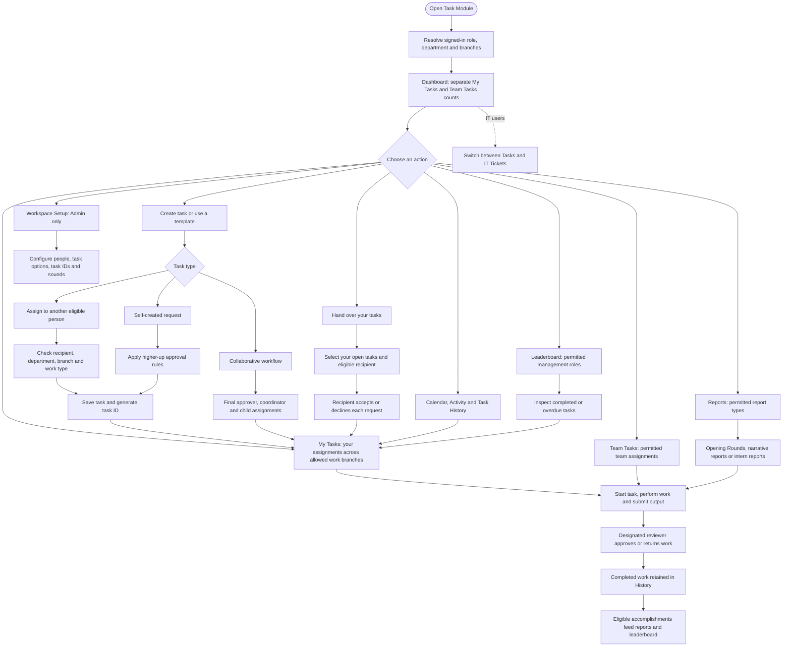
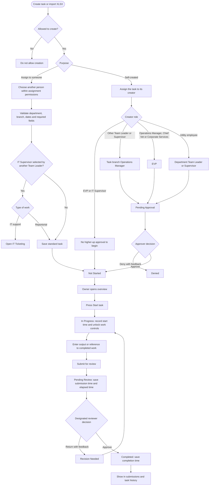
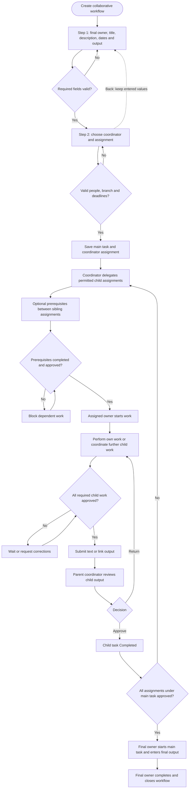
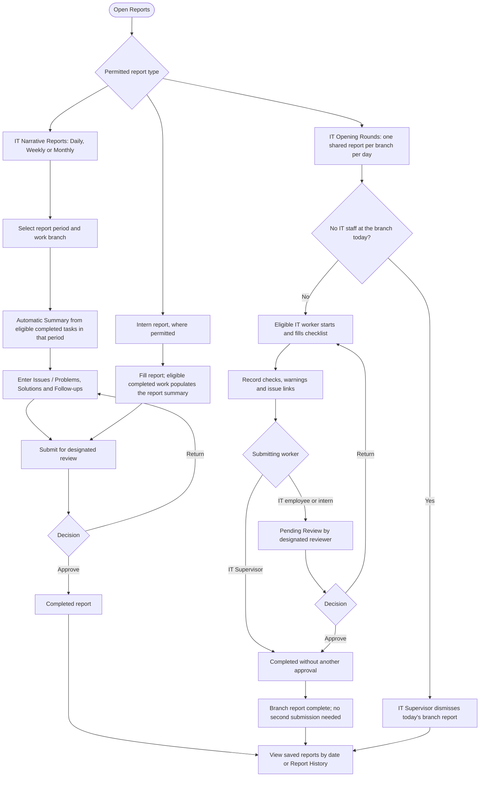
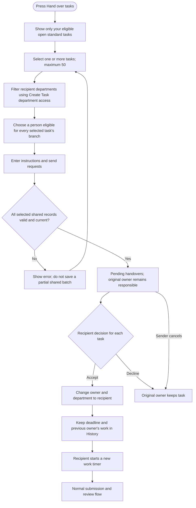
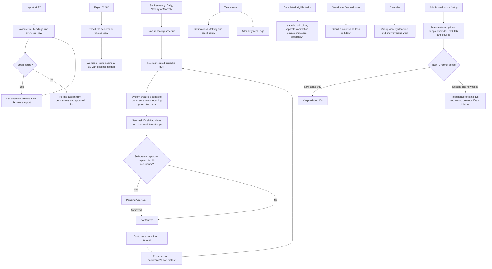

# Task Module — Current workflow

Workflow reference updated November 21, 2026. See [Leaderboard scoring](task-module-scoring.md) for the versioned rubric, evidence, allocations and tests. This describes the current rules, not a claim that every role has been tested. IT Ticketing is a separate project and appears here only as a navigation destination.

## 1. Module overview

## 2. Standard tasks and self-created requests

Creation approval and output review are different decisions. Assigning another person does not automatically require OM approval to begin. Team Leaders assigning another person review that person's output; other tasks use the designated reviewer resolved by the system. Standard assignment cannot be used to assign yourself. Ordinary employees do not create standard assignments; Utility has the self-created exception. Missing approvers or invalid permissions block saving rather than granting approval.

## 3. Collaborative workflow

Every parent/coordinator submission and child submission needs text or a link. A child deadline may be the same as its parent's deadline, but cannot be later. A task cannot start before its prerequisites are approved. A coordinator with child assignments cannot hand over that coordinating task through the standard handover flow.

## 4. Reports

Report visibility follows role and report permissions. A completed task must belong to the relevant person and reporting period to appear in their automatic accomplishments. Opening Rounds warnings are shown in both tile and list views. Completing today's shared branch report does not complete another branch or another day.

## 5. Single or multiple task handovers

Tasks awaiting creation approval or output review, closed tasks, tasks with a pending handover, and coordinating tasks with children are excluded. Future repetitions remain with the original recurring-task owner. The recipient accepts each task separately; sending a request does not transfer responsibility immediately. Employees' handovers stay within their own department; management department choices follow the departments available through Create Task.

## 6. Repeating tasks and supporting features

Recurring tasks create separate records; they do not erase the previous period's work. Approval waits and output review are distinct from work in progress. Leaderboard demo values are simulated and separate from actual accomplishments. Display preferences include dark mode and compatibility mode. Workspace person overrides affect the Task Module; Employee Management remains the staff source.

## Code references

- `app/Services/TaskModuleAccess.php`: roles, assignment access and reviewer resolution.
- `app/Services/TaskModuleWriter.php`: task creation, approvals, work timestamps, submissions and collaborative checks.
- `app/Services/TaskModuleTurnover.php` and `app/Http/Controllers/TaskModuleController.php`: single and multiple handovers.
- `app/Services/TaskModuleRecurrence.php`: recurring occurrences.
- `resources/js/Pages/Tasks/Index.jsx`: navigation, preview behavior and task/report interfaces.
- `resources/js/Pages/Tasks/taskApproval.mjs`, `collaborativeTasks.mjs`, `taskCsv.mjs`: preview approval, collaboration and import flows.

## Interface wording (20 November 2026)

Decorative dashboard greetings, taglines, task-form introductions and cat-themed list/leaderboard phrases were removed or replaced with plain headings and empty-state messages. Functional workflow instructions, counts, filters and permission rules remain unchanged.

24 November 2026: The scoring rubric now uses raw Time (0-2) + Priority (0/2/4/7) + Returns (0/0.5/1) points, maximum 10. The user confirmed full final-completer allocation after handovers, superseding the former 50% shared pool. Low can earn up to 3 points. See task-module-scoring.md for rules, policy migration, examples and tests. Role preview remains restored for local testing.
